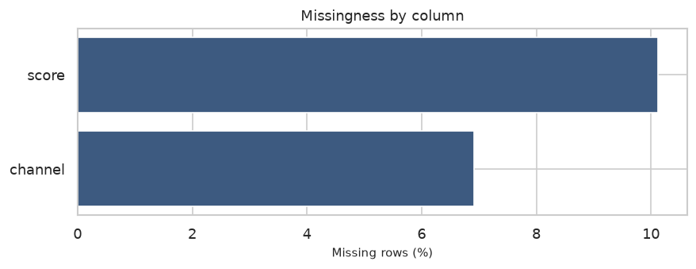
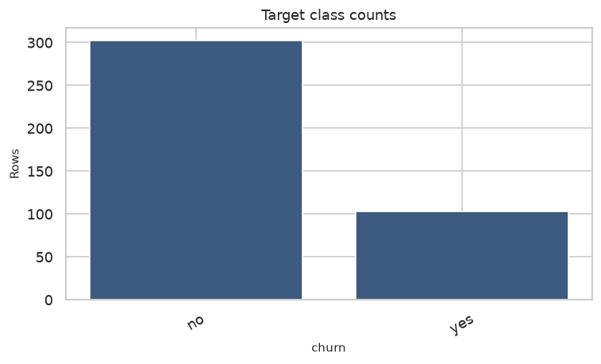
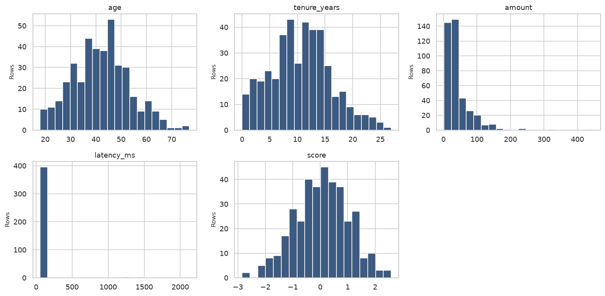
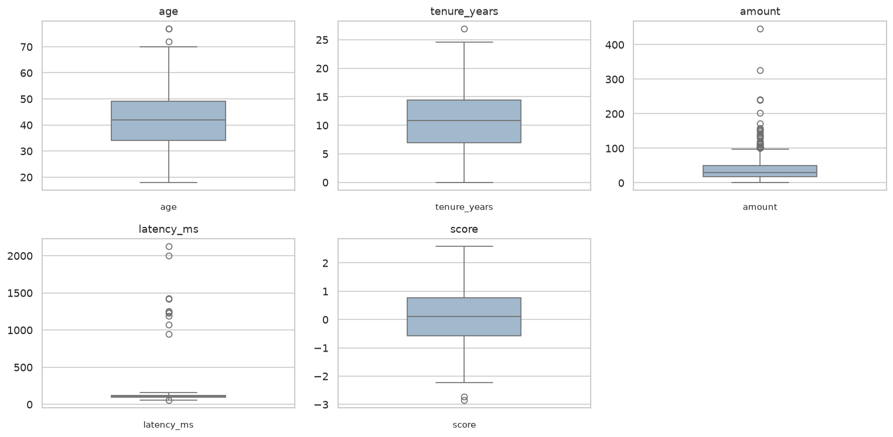
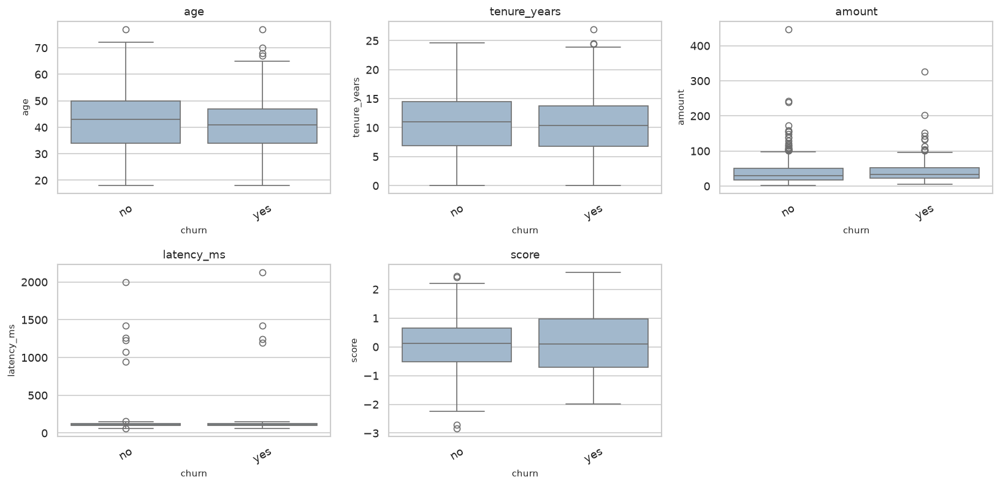
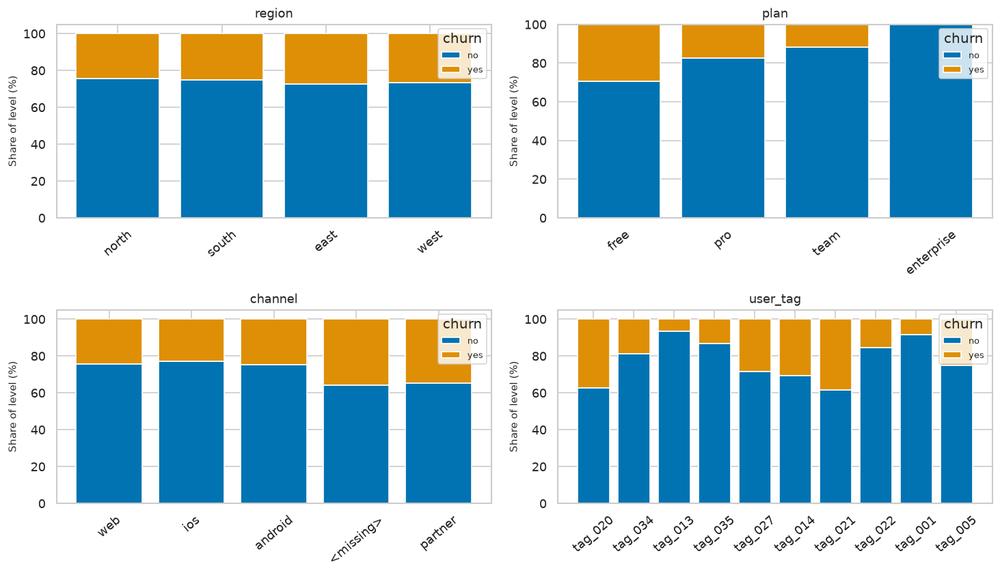
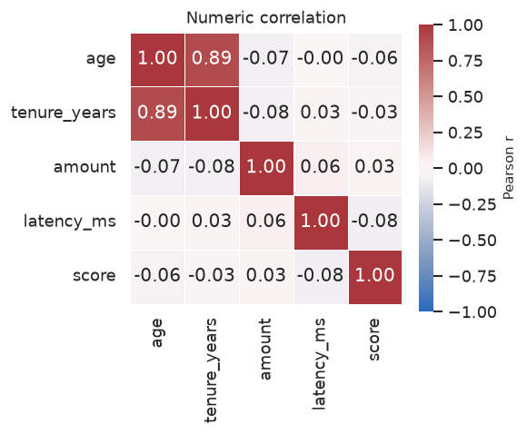

# Exploratory data analysis

Target: `churn`.
Task: classification (auto).
The target dtype is str, which is not numeric, so the task is classification.

## Method

Task detection (`auto`): a boolean, categorical, or string target is classification; a numeric target is classification when it has at most 10 distinct non-null values, and regression otherwise. A target with no non-null values follows its storage type (numeric -> regression, otherwise classification). An explicit task value replaces this rule. Constant means fewer than 2 distinct non-null values. Near-constant means the most common non-null value is at least 95% of non-null rows. Imbalanced, for classification, means the largest class is at least 70% and the target is not constant or near-constant. Skew is the bias-corrected Fisher-Pearson coefficient; a column is flagged when |skew| >= 1. Quartiles are linear percentiles. Standard deviation uses the sample divisor (n-1). An IQR outlier is a finite value outside [Q1 - 1.5*IQR, Q3 + 1.5*IQR]. A categorical level is rare when its share of non-null rows is at most 1%. High cardinality means at least 20 distinct non-null levels, or a distinct value on every non-null row when that row count is at least 10. A high correlation is a Pearson |r| >= 0.7 on pairwise-complete rows. The preview is the first 5 rows of the file, not a random sample. Charts show at most 10 levels of a categorical column, at most 40 columns on the missingness chart, and at most 9 panels per figure. Scatter plots sample down to 5000 points when a pair is larger. Tables and correlations still use every row.

## 1. Shape, dtypes, memory, and sample rows

The table has 405 rows and 10 columns.
Source: `eda/data/sample_classification.csv`.
Pandas deep memory: 120.9 KB (123759 bytes).

### Column types

| column | dtype | kind | role | non-null | distinct |
| --- | --- | --- | --- | --- | --- |
| age | int64 | numeric | feature | 405 | 53 |
| tenure_years | float64 | numeric | feature | 405 | 343 |
| amount | float64 | numeric | feature | 405 | 387 |
| latency_ms | float64 | numeric | feature | 405 | 306 |
| score | float64 | numeric | feature | 364 | 348 |
| region | str | categorical | feature | 405 | 4 |
| plan | str | categorical | feature | 405 | 4 |
| channel | str | categorical | feature | 377 | 4 |
| user_tag | str | categorical | feature | 405 | 40 |
| churn | str | categorical | target | 405 | 2 |

### Sample rows

| age | tenure_years | amount | latency_ms | score | region | plan | channel | user_tag | churn |
| --- | --- | --- | --- | --- | --- | --- | --- | --- | --- |
| 46 | 12.150 | 14.610 | 86.200 | 0.777 | east | free | ios | tag_029 | no |
| 30 | 5.890 | 11.930 | 101.200 | 0.247 | east | team | partner | tag_007 | no |
| 51 | 16.900 | 40.160 | 117.600 | 0.962 | west | team | web | tag_023 | no |
| 53 | 14.770 | 41.360 | 108.200 | 1.376 | north | free | android | tag_035 | no |
| 19 | 1.750 | 89.500 | 98.300 | 0.392 | north | free | ios | tag_036 | no |

The preview is the first 5 rows of the file.

## 2. Duplicate rows

A duplicate is an exact match on every column, including the target. Extra copies count rows after the first occurrence. Rows in a duplicated group count every row that shares its values with another row.

Extra copies: 5 (1.2% of 405 rows).
Rows in a duplicated group: 10.

## 3. Missingness

Missing cells: 69 of 4050 (1.7%).
Rows with at least one missing value: 67 (16.5%).
Most missing cells in one row: 2.

### By column

| column | missing rows | missing rate |
| --- | --- | --- |
| age | 0 | 0.0% |
| tenure_years | 0 | 0.0% |
| amount | 0 | 0.0% |
| latency_ms | 0 | 0.0% |
| score | 41 | 10.1% |
| region | 0 | 0.0% |
| plan | 0 | 0.0% |
| channel | 28 | 6.9% |
| user_tag | 0 | 0.0% |
| churn | 0 | 0.0% |

### By row

| missing cells in the row | rows | share of rows |
| --- | --- | --- |
| 0 | 338 | 83.5% |
| 1 | 65 | 16.0% |
| 2 | 2 | 0.5% |

Share of rows missing, for columns that have a missing value.

## 4. Target profile

Target `churn`, task classification.
The target dtype is str, which is not numeric, so the task is classification.

Non-null values: 405. Missing: 0 (0.0%). Distinct non-null values: 2.

The target is imbalanced.

| class | rows | share of non-null |
| --- | --- | --- |
| no | 302 | 74.6% |
| yes | 103 | 25.4% |

Target class counts.

## 5. Numeric univariates

Count is the number of finite values. Missing is the number of empty cells. Non-finite values, if any, are excluded from the summaries and counted separately. Outlier rate uses the finite count as the denominator.

| column | count | missing | mean | std | min | q1 | median | q3 | max | skew | lower fence | upper fence | IQR outliers | outlier rate |
| --- | --- | --- | --- | --- | --- | --- | --- | --- | --- | --- | --- | --- | --- | --- |
| age | 405 | 0 | 41.965 | 11.345 | 18.000 | 34.000 | 42.000 | 49.000 | 77.000 | 0.171 | 11.500 | 71.500 | 3 | 0.7% |
| tenure_years | 405 | 0 | 10.677 | 5.511 | 0.000 | 6.900 | 10.820 | 14.380 | 26.960 | 0.233 | -4.320 | 25.600 | 1 | 0.2% |
| amount | 405 | 0 | 42.645 | 43.330 | 1.350 | 18.200 | 30.320 | 50.620 | 446.760 | 3.848 | -30.430 | 99.250 | 36 | 8.9% |
| latency_ms | 405 | 0 | 140.233 | 208.221 | 56.800 | 96.900 | 109.600 | 122.800 | 2126.900 | 6.888 | 58.050 | 161.650 | 11 | 2.7% |
| score | 364 | 41 | 0.069 | 0.972 | -2.848 | -0.569 | 0.110 | 0.758 | 2.587 | -0.124 | -2.560 | 2.749 | 2 | 0.5% |

Histograms of the numeric features.

Boxplots of the numeric features; points beyond the whiskers are IQR outliers.

## 6. Categorical univariates

Cardinality and level shares use non-null values. The frequency table shows the 10 most common levels. A level is rare when its share of non-null rows is at most 1%.

### `region`

Cardinality: 4. Non-null: 405. Missing: 0 (0.0%). High cardinality: no.

Top levels:

| level | rows | share of non-null |
| --- | --- | --- |
| north | 169 | 41.7% |
| south | 107 | 26.4% |
| east | 84 | 20.7% |
| west | 45 | 11.1% |

Rare levels: none.

### `plan`

Cardinality: 4. Non-null: 405. Missing: 0 (0.0%). High cardinality: no.

Top levels:

| level | rows | share of non-null |
| --- | --- | --- |
| free | 288 | 71.1% |
| pro | 81 | 20.0% |
| team | 34 | 8.4% |
| enterprise | 2 | 0.5% |

Rare levels: 1.

| level | rows | share of non-null |
| --- | --- | --- |
| enterprise | 2 | 0.5% |

### `channel`

Cardinality: 4. Non-null: 377. Missing: 28 (6.9%). High cardinality: no.

Top levels:

| level | rows | share of non-null |
| --- | --- | --- |
| web | 189 | 50.1% |
| ios | 100 | 26.5% |
| android | 65 | 17.2% |
| partner | 23 | 6.1% |

Rare levels: none.

### `user_tag`

Cardinality: 40. Non-null: 405. Missing: 0 (0.0%). High cardinality: yes.

Top levels:

| level | rows | share of non-null |
| --- | --- | --- |
| tag_020 | 16 | 4.0% |
| tag_034 | 16 | 4.0% |
| tag_013 | 15 | 3.7% |
| tag_035 | 15 | 3.7% |
| tag_027 | 14 | 3.5% |
| tag_014 | 13 | 3.2% |
| tag_021 | 13 | 3.2% |
| tag_022 | 13 | 3.2% |
| tag_001 | 12 | 3.0% |
| tag_005 | 12 | 3.0% |

Rare levels: none.

## 7. Feature vs target

Rows with a missing target are excluded from this section.

### Numeric features

Each cell uses the finite values of that feature inside the class.

| feature | class | finite n | mean | median |
| --- | --- | --- | --- | --- |
| age | no | 302 | 42.146 | 43.000 |
| age | yes | 103 | 41.437 | 41.000 |
| tenure_years | no | 302 | 10.646 | 10.965 |
| tenure_years | yes | 103 | 10.767 | 10.390 |
| amount | no | 302 | 41.375 | 28.790 |
| amount | yes | 103 | 46.368 | 33.500 |
| latency_ms | no | 302 | 132.300 | 109.600 |
| latency_ms | yes | 103 | 163.493 | 110.500 |
| score | no | 271 | 0.045 | 0.111 |
| score | yes | 93 | 0.139 | 0.097 |

Numeric features against the target.

### Categorical features

Each table keeps the 10 largest levels. A `<missing>` level is kept as well when that feature has empty cells.

#### `region`

| level | n | no | yes |
| --- | --- | --- | --- |
| north | 169 | 75.7% | 24.3% |
| south | 107 | 74.8% | 25.2% |
| east | 84 | 72.6% | 27.4% |
| west | 45 | 73.3% | 26.7% |

Rates are the share of this level, among rows with a non-null target.

#### `plan`

| level | n | no | yes |
| --- | --- | --- | --- |
| free | 288 | 70.5% | 29.5% |
| pro | 81 | 82.7% | 17.3% |
| team | 34 | 88.2% | 11.8% |
| enterprise | 2 | 100.0% | 0.0% |

Rates are the share of this level, among rows with a non-null target.

#### `channel`

| level | n | no | yes |
| --- | --- | --- | --- |
| web | 189 | 75.7% | 24.3% |
| ios | 100 | 77.0% | 23.0% |
| android | 65 | 75.4% | 24.6% |
| <missing> | 28 | 64.3% | 35.7% |
| partner | 23 | 65.2% | 34.8% |

Rates are the share of this level, among rows with a non-null target.

#### `user_tag`

30 levels are omitted from this table.

| level | n | no | yes |
| --- | --- | --- | --- |
| tag_020 | 16 | 62.5% | 37.5% |
| tag_034 | 16 | 81.2% | 18.8% |
| tag_013 | 15 | 93.3% | 6.7% |
| tag_035 | 15 | 86.7% | 13.3% |
| tag_027 | 14 | 71.4% | 28.6% |
| tag_014 | 13 | 69.2% | 30.8% |
| tag_021 | 13 | 61.5% | 38.5% |
| tag_022 | 13 | 84.6% | 15.4% |
| tag_001 | 12 | 91.7% | 8.3% |
| tag_005 | 12 | 75.0% | 25.0% |

Rates are the share of this level, among rows with a non-null target.

Categorical features against the target.

## 8. Numeric correlation

Pearson correlation on pairwise-complete rows. The matrix includes every numeric column, including a numeric target.

| column | age | tenure_years | amount | latency_ms | score |
| --- | --- | --- | --- | --- | --- |
| age | 1.000 | 0.892 | -0.072 | -0.004 | -0.060 |
| tenure_years | 0.892 | 1.000 | -0.078 | 0.028 | -0.032 |
| amount | -0.072 | -0.078 | 1.000 | 0.059 | 0.028 |
| latency_ms | -0.004 | 0.028 | 0.059 | 1.000 | -0.083 |
| score | -0.060 | -0.032 | 0.028 | -0.083 | 1.000 |

Pairs with |r| >= 0.7:

| column | column | pearson r |
| --- | --- | --- |
| age | tenure_years | 0.892 |

Numeric correlation matrix.

## 9. Findings

- 5 rows are exact copies of an earlier row (1.2% of 405 rows). 10 rows belong to a duplicated group.
- Missing values: score (41/405, 10.1%); channel (28/405, 6.9%).
- 67 of 405 rows have at least one missing value (16.5%). The most missing cells in a single row is 2.
- Target `churn` is imbalanced: no is 302/405 non-null rows (74.6%).
- Skewed numeric features: latency_ms is right-skewed (skew 6.888); amount is right-skewed (skew 3.848).
- IQR outliers: amount has 36 of 405 finite values outside the fences (8.9%); latency_ms has 11 of 405 finite values outside the fences (2.7%); age has 3 of 405 finite values outside the fences (0.7%); score has 2 of 364 finite values outside the fences (0.5%); tenure_years has 1 of 405 finite values outside the fences (0.2%).
- High-cardinality categorical features: user_tag (40 levels).
- Rare levels: plan (1): enterprise (2 rows).
- High correlations: age and tenure_years (r = 0.892).
