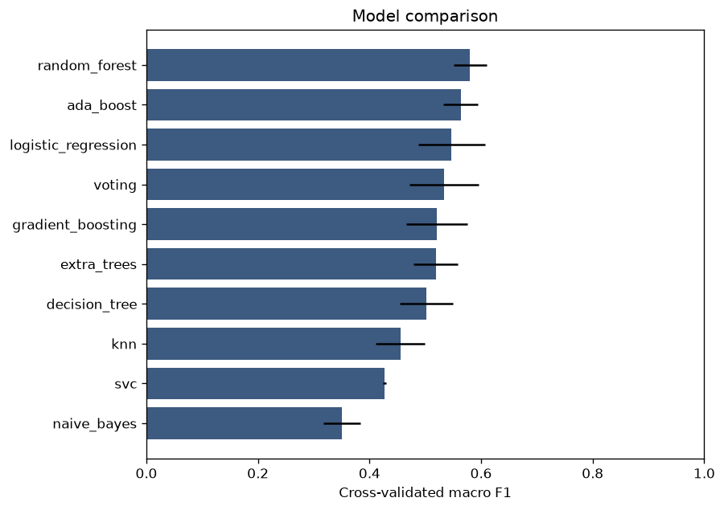
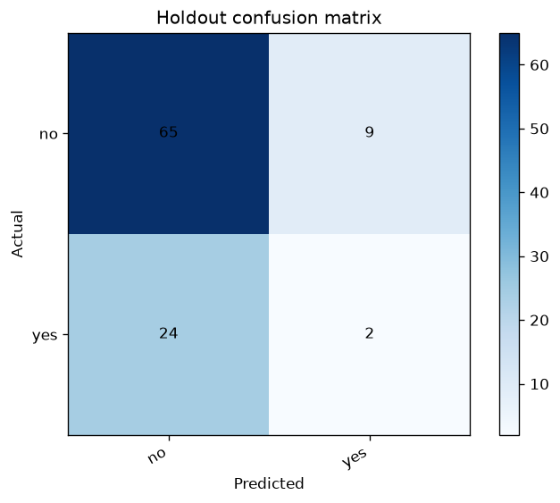
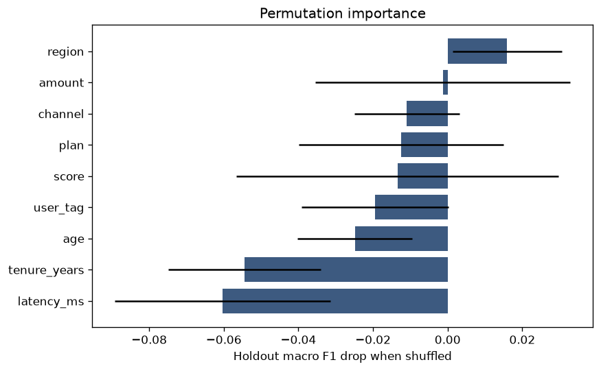

# Classification model comparison

python -m models --data eda/data/sample_classification.csv --target churn --out models/examples/sample_report --test-size 0.25 --seed 42 --cv 5

Hyperparameters are fixed. They are not searched.

## Data

Source: `eda/data/sample_classification.csv`.
Target: `churn`.
Rows loaded: 405. Rows with a missing target removed: 0. Exact duplicate rows removed: 5. Rows used: 400.
Training rows: 300. Holdout rows: 100. Test fraction: 0.25. Seed: 42. Stratified folds: 5.

Numeric features: `age`, `tenure_years`, `amount`, `latency_ms`, `score`.
Categorical features: `region`, `plan`, `channel`, `user_tag`.

Class counts on the rows used for the split:

| class | rows | share |
| --- | --- | --- |
| no | 297 | 0.743 |
| yes | 103 | 0.258 |

Empty feature cells are imputed inside the training pipeline: median for numeric columns and the most frequent value for categorical columns. Numeric columns are standardized. Categorical columns are one-hot encoded. The holdout rows are not used to fit those steps.

ROC-AUC is the ranking score for class `yes` (the later of the two labels in sorted order).

## Leaderboard

Selected model: `random_forest`.
`random_forest` has the highest mean cross-validated macro F1 (0.580), 0.017 above `ada_boost` (0.564). The holdout was not used to choose it.

On this holdout, accuracy 0.670 is below the majority-class accuracy 0.740.
Holdout macro F1 0.453 is above the majority-class macro F1 0.425.
Holdout ROC-AUC is 0.488, below 0.5 on this split.
Cross-validated ROC-AUC (0.690) is higher than the holdout ROC-AUC (0.488).

| model | CV F1 | CV F1 std | CV accuracy | CV ROC-AUC | holdout accuracy | holdout precision | holdout recall | holdout F1 | holdout ROC-AUC |
| --- | --- | --- | --- | --- | --- | --- | --- | --- | --- |
| random_forest | 0.580 | 0.030 | 0.730 | 0.690 | 0.670 | 0.456 | 0.478 | 0.453 | 0.488 |
| ada_boost | 0.564 | 0.031 | 0.727 | 0.668 | 0.680 | 0.515 | 0.509 | 0.500 | 0.449 |
| logistic_regression | 0.547 | 0.059 | 0.603 | 0.592 | 0.520 | 0.449 | 0.439 | 0.439 | 0.464 |
| voting | 0.534 | 0.062 | 0.670 | 0.571 | 0.610 | 0.437 | 0.450 | 0.441 | 0.449 |
| gradient_boosting | 0.521 | 0.055 | 0.700 | 0.647 | 0.600 | 0.431 | 0.443 | 0.435 | 0.392 |
| extra_trees | 0.519 | 0.040 | 0.623 | 0.564 | 0.610 | 0.456 | 0.462 | 0.458 | 0.496 |
| decision_tree | 0.502 | 0.048 | 0.570 | 0.521 | 0.530 | 0.465 | 0.458 | 0.455 | 0.464 |
| knn | 0.456 | 0.044 | 0.713 | 0.489 | 0.720 | 0.495 | 0.499 | 0.451 | 0.619 |
| svc | 0.426 | 0.003 | 0.743 | 0.523 | 0.740 | 0.370 | 0.500 | 0.425 | 0.510 |
| naive_bayes | 0.351 | 0.033 | 0.353 | 0.481 | 0.280 | 0.411 | 0.451 | 0.266 | 0.475 |

Precision, recall, and F1 on this table are macro averages.

## Selected model

The sections below are the selected model's validation detail.

## random_forest

Random forest of 300 trees with balanced bootstrap samples and at least 2 rows in each leaf.

### Cross-validation on the training rows

| metric | mean | std across folds |
| --- | --- | --- |
| accuracy | 0.730 | 0.043 |
| precision, macro | 0.636 | 0.069 |
| recall, macro | 0.577 | 0.024 |
| F1, macro | 0.580 | 0.030 |
| F1, weighted | 0.702 | 0.030 |
| ROC-AUC | 0.690 | 0.077 |

### Holdout

| metric | value |
| --- | --- |
| accuracy | 0.670 |
| precision, macro | 0.456 |
| recall, macro | 0.478 |
| F1, macro | 0.453 |
| precision, weighted | 0.588 |
| recall, weighted | 0.670 |
| F1, weighted | 0.618 |
| ROC-AUC | 0.488 |
| log loss | 0.631 |

### Per class

| class | precision | recall | F1 | support |
| --- | --- | --- | --- | --- |
| no | 0.730 | 0.878 | 0.798 | 74 |
| yes | 0.182 | 0.077 | 0.108 | 26 |

### Confusion matrix

| actual \ predicted | no | yes |
| --- | --- | --- |
| no | 65 | 9 |
| yes | 24 | 2 |

### Majority-class baseline on the same holdout

Every holdout row is predicted as `no`.

| metric | baseline | model |
| --- | --- | --- |
| accuracy | 0.740 | 0.670 |
| precision, macro | 0.370 | 0.456 |
| recall, macro | 0.500 | 0.478 |
| F1, macro | 0.425 | 0.453 |

### Permutation importance

Each value is the drop in holdout macro F1 when that original column is shuffled. Ten shuffles are averaged. A negative value means the shuffled column scored higher.

| feature | mean F1 drop | std |
| --- | --- | --- |
| region | 0.0159 | 0.0146 |
| amount | -0.0013 | 0.0342 |
| channel | -0.0109 | 0.0142 |
| plan | -0.0125 | 0.0274 |
| score | -0.0135 | 0.0431 |
| user_tag | -0.0195 | 0.0198 |
| age | -0.0249 | 0.0154 |
| tenure_years | -0.0544 | 0.0204 |
| latency_ms | -0.0603 | 0.0289 |

### Model-internal weights

impurity importance on transformed columns. These are on the transformed columns, so a standardized numeric feature and a one-hot level are not in the same unit.

| transformed feature | source column | weight |
| --- | --- | --- |
| numeric__amount | amount | 0.1570 |
| numeric__score | score | 0.1502 |
| numeric__latency_ms | latency_ms | 0.1392 |
| numeric__tenure_years | tenure_years | 0.1113 |
| numeric__age | age | 0.0963 |
| categorical__plan_free | plan | 0.0373 |
| categorical__plan_pro | plan | 0.0243 |
| categorical__channel_web | channel | 0.0193 |
| categorical__channel_ios | channel | 0.0188 |
| categorical__region_south | region | 0.0166 |
| categorical__user_tag_tag_007 | user_tag | 0.0158 |
| categorical__region_east | region | 0.0150 |
| categorical__region_north | region | 0.0146 |
| categorical__channel_android | channel | 0.0127 |
| categorical__region_west | region | 0.0115 |
